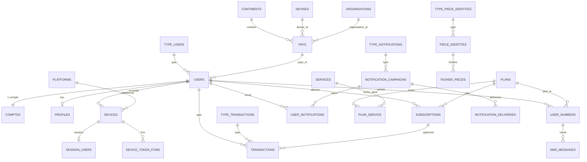

# Cartographie base de données — AfriServer

> Snapshot vivant au **30 oct. 2026** (schéma MySQL `afriserver`).  
> Les tables marquées 🔮 sont **prévues** (plan wallet) mais **pas encore migrées**.

---

## Vue d’ensemble (domaines)

```text
┌─────────────────┐     ┌──────────────────┐     ┌────────────────────┐
│  RÉFÉRENTIELS   │     │   IDENTITÉ /     │     │  WALLET / MONEY    │
│  continents     │     │   AUTH           │     │  comptes            │
│  devises        │◄────│  users           │────►│  transactions      │
│  pays           │     │  type_users      │     │  type_transactions │
│  organisations  │     │  otp / reset     │     │  🔮 transferts     │
│  platforms      │     │  tokens Sanctum  │     │  🔮 frais_*        │
└────────┬────────┘     └────────┬─────────┘     │  🔮 journal_*      │
         │                       │               └─────────┬──────────┘
         │                       │                         │
         │              ┌────────▼─────────┐      ┌────────▼──────────┐
         │              │  DEVICES /       │      │  OFFRE / NUMÉROS  │
         │              │  SESSIONS        │      │  plans, services  │
         │              │  devices         │      │  subscriptions    │
         │              │  session_users   │      │  user_numbers     │
         │              │  device_token_fcms│     │  sms_messages     │
         │              └──────────────────┘      └───────────────────┘
         │
┌────────▼──────────┐   ┌──────────────────┐     ┌────────────────────┐
│  KYC / PIÈCES     │   │  NOTIFICATIONS   │     │  SYSTÈME           │
│  profiles         │   │  type_notif.     │     │  jobs, cache       │
│  piece_identites  │   │  campaigns       │     │  observability     │
│  fichier_pieces   │   │  deliveries      │     │  permissions/roles │
│  type_piece_*     │   │  user_notif.     │     └────────────────────┘
└───────────────────┘   └──────────────────┘
```

---

## Diagramme ER (cœur métier)



---

## 1. Référentiels géo / orga / devise

### `continents`
| Colonne | Type | Notes |
|---|---|---|
| id | bigint PK | |
| label, code | varchar | `code` unique |
| description | varchar? | |
| actif | bool | |

### `devises`
| Colonne | Type | Notes |
|---|---|---|
| id | bigint PK | |
| code | varchar(3) unique | XAF, USD, EUR… |
| label | varchar | |
| symbole | varchar | FCFA, $, € |
| actif | bool | |

### `organisations`
| Colonne | Type | Notes |
|---|---|---|
| id | bigint PK | |
| label, description?, actif | | Tenant / marque |

### `pays`
| Colonne | Type | Notes |
|---|---|---|
| id | bigint PK | |
| continent_id | FK → continents | |
| organisation_id | FK → organisations? | Pays rattaché à la plateforme |
| devise_id | FK → devises? | |
| label, code | | ISO (ex. CG) |
| currency_code, currency_symbol | | Dénormalisé depuis devise |
| exchange_rate | decimal | Local → USD |
| indicatif, timezone, description?, actif | | |

### `platforms`
Référentiel appareils (`ios`, `android`, …).

### `type_users`
`admin`, user API, etc.

### `type_piece_identites` / `type_notifications` / `type_transactions`
Référentiels catalogue (KYC, notifs, paiements).

---

## 2. Identité & auth

### `users` (cœur)
| Colonne | Type | Notes |
|---|---|---|
| id | bigint PK | |
| pays_id | FK → pays? | |
| type_user_id | FK → type_users? | |
| name, first_name | | |
| email | unique | |
| phone_number | unique | |
| statut | enum | actif / dormant / inactif |
| status_valide | enum | non_valide / valide (KYC) |
| password | | |
| failed_login_attempts, locked_until | | anti brute-force |
| ~~balance~~ | — | **supprimé** → `comptes.solde` |

### Auth auxiliaire
| Table | Rôle |
|---|---|
| `otp_verifications` | OTP login / register |
| `password_reset_codes` | Reset mobile / admin |
| `password_reset_tokens` | Laravel classique |
| `personal_access_tokens` | Sanctum |
| `sessions` | Session web |

---

## 3. Wallet / argent

### `comptes` ✅
| Colonne | Type | Notes |
|---|---|---|
| id | bigint PK | |
| numero_compte | varchar unique | ex. `AFN000009…` |
| solde | decimal(20,8) | **Ledger USD**, ≥ 0 |
| statut | enum | ACTIF / SUSPENDU / FERME |
| user_id | FK → users **unique** | 1 compte / user |

### `transactions` ✅
| Colonne | Type | Notes |
|---|---|---|
| id, uid | PK + uuid unique | `uid` = tx_ref PSP |
| user_id | FK → users | |
| subscription_id?, plan_id? | FK | |
| type_transaction_id | FK → type_transactions | topup, number, … |
| amount, currency | | amount en pratique USD ledger |
| payment_method, provider?, external_ref? | | momo, flutterwave… |
| status | | pending / paid / failed / expired |
| payload | json? | |
| expires_at?, paid_at? | | |

### `type_transactions` (codes actuels)
`subscription`, `renewal`, `upgrade`, `topup`, `number`, `forfait`  
À ajouter (plan) : `transfer_w2w`, `transfer_w2e`, `fee`, `refund`.

### 🔮 Prévu (pas encore en BDD)

#### `transferts`
Lien expéditeur / destinataire pour W2W et W2E  
(`compte_expediteur_id`, `compte_destinataire_id?`, `destinataire_externe?`, `status`, FK transactions).

#### `frais_transaction`
`type_operation`, `montant_fixe`, `taux_pourcentage`, `pays_id?`, `statut`.

#### `journal_mouvements`
Audit CREDIT/DEBIT : `montant_usd`, `solde_avant`, `solde_apres`, `compte_id`, `transaction_id`.

---

## 4. Devices & sessions

```text
users 1──* devices *──1 platforms
              │
              ├──1 session_users (geo / IP / réseau)
              └──* device_token_fcms (tokens push)
```

| Table | Rôle |
|---|---|
| `devices` | Appareil lié au user |
| `session_users` | Session active + localisation |
| `device_token_fcms` | FCM token (lié session device) |

---

## 5. Offre, abonnements, numéros

```text
plans *──* services  (via plan_service)
  │
  ├──* subscriptions (user)
  └──* user_numbers →* sms_messages
```

| Table | Rôle |
|---|---|
| `plans` | free / basic / pro (prix, durée, max_numbers) |
| `services` | capacités (SMS, appels…) |
| `plan_service` | pivot + quota |
| `subscriptions` | abonnement user (status, dates, auto_renew) |
| `user_numbers` | numéros virtuels achetés (UUID) |
| `sms_messages` | SMS reçus sur un user_number |

---

## 6. KYC / pièces

```text
users 1──1 profiles (status KYC, documents json)
type_piece_identites 1──* piece_identites 1──* fichier_pieces
```

| Table | Rôle |
|---|---|
| `profiles` | Statut vérification (UUID PK) |
| `piece_identites` | Pièce + statut / motif refus |
| `fichier_pieces` | Fichiers uploadés (chemins) |

---

## 7. Notifications

```text
type_notifications
       │
notification_campaigns ──┬── notification_campaign_user
                         ├── notification_campaign_device
                         ├── notification_deliveries
                         └── user_notifications (inbox)
```

Audience campagne : all / users / organisation / pays.

---

## 8. Droits admin (Spatie)

`roles`, `permissions`, `model_has_roles`, `model_has_permissions`, `role_has_permissions`.

---

## 9. Observabilité & infra Laravel

| Table | Rôle |
|---|---|
| `observability_logs` | Audit API (avant/après, session, erreur) |
| `jobs`, `job_batches`, `failed_jobs` | Queues |
| `cache`, `cache_locks` | Cache |
| `migrations` | Historique migrations |

---

## Relations clés (FK réelles)

| De | Vers |
|---|---|
| `pays.continent_id` | `continents` |
| `pays.organisation_id` | `organisations` |
| `pays.devise_id` | `devises` |
| `users.pays_id` | `pays` |
| `users.type_user_id` | `type_users` |
| `comptes.user_id` | `users` (unique) |
| `devices.user_id` / `platform_id` | `users` / `platforms` |
| `transactions.user_id` / `type_transaction_id` | `users` / `type_transactions` |
| `subscriptions.user_id` / `plan_id` | `users` / `plans` |
| `user_numbers.user_id` | `users` |
| `sms_messages.user_number_id` | `user_numbers` |
| `profiles.user_id` | `users` |

---

## Flux argent (cible)

```text
                    ┌──────────────┐
     Flutterwave    │              │     W2W atomique
     topup webhook  │   COMPTES    │◄──────────────────► COMPTES (autre user)
     ──────────────►│   .solde     │
                    │   (USD)      │──── W2E payout ───► MoMo / banque
                    └──────┬───────┘
                           │
                    transactions
                    (+ 🔮 transferts / journal / frais)
                           │
                    achat user_numbers
```

| Flux | Tables touchées | Statut |
|---|---|---|
| Recharge | `transactions` + `comptes` | stub local ; prod = Flutterwave à faire |
| Achat numéro | `transactions` + `comptes` + `user_numbers` | partiel |
| W2W | + `transferts` + journal + frais | 🔮 |
| W2E | + `transferts` + payout webhook | 🔮 |

---

## Inventaire tables applicatives

### Présentes
`continents`, `devises`, `organisations`, `pays`, `platforms`, `type_users`, `type_piece_identites`, `type_notifications`, `type_transactions`, `users`, `comptes`, `otp_verifications`, `password_reset_codes`, `password_reset_tokens`, `personal_access_tokens`, `sessions`, `devices`, `session_users`, `device_token_fcms`, `plans`, `services`, `plan_service`, `subscriptions`, `transactions`, `user_numbers`, `sms_messages`, `profiles`, `piece_identites`, `fichier_pieces`, `notification_campaigns`, `notification_campaign_user`, `notification_campaign_device`, `notification_deliveries`, `user_notifications`, `roles`, `permissions`, `model_has_roles`, `model_has_permissions`, `role_has_permissions`, `observability_logs`, `jobs`, `job_batches`, `failed_jobs`, `cache`, `cache_locks`, `migrations`

### Prévues (wallet plan — `tache.md`)
`transferts`, `frais_transaction`, `journal_mouvements`

---

## Légende

| Symbole | Signification |
|---|---|
| ✅ | En production schema actuelle |
| 🔮 | Planifié, pas encore migré |
| FK | Clé étrangère contrainte en BDD |
| `?` | Colonne nullable |

---

*Fichier généré pour navigation humaine. Pour le détail d’implémentation wallet, voir [`tache.md`](tache.md).*
