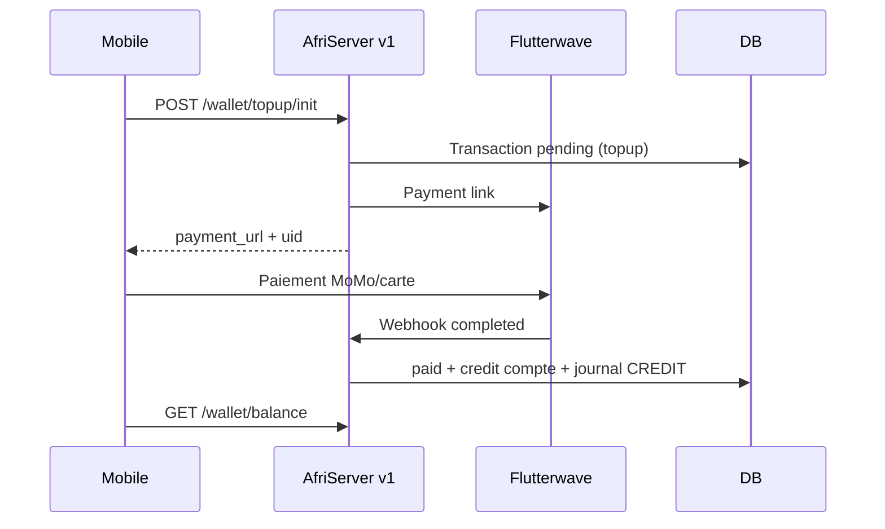
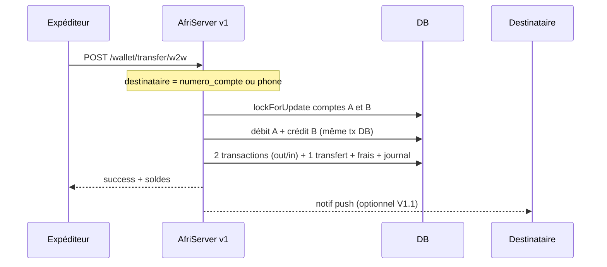
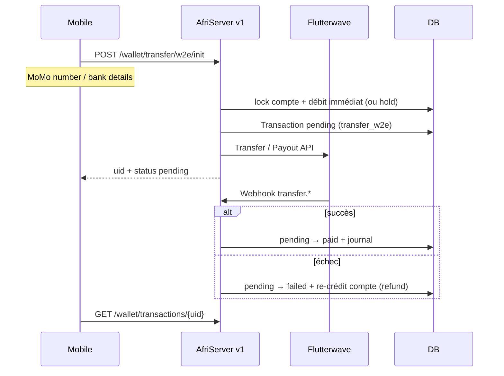

# Wallet AfriServer — Plan (recharge + transferts)

> Objectif produit : wallet utilisateur avec  
> 1) **Recharge** (MoMo / carte → wallet)  
> 2) **Wallet → Wallet** (transfert interne AfriNumber)  
> 3) **Wallet → External** (sortie vers MoMo / banque via PSP)  
> 4) **Achat numéro** débité du solde  
>
> Solde unique : `comptes.solde` (USD).  
> Jamais créditer / débiter définitivement sur un `init` sans confirmation (webhook ou validation atomique interne).

---

## Décisions figées

| Choix | Décision |
|---|---|
| Solde | `comptes.solde` (1 compte / user) — **plus** de `users.balance` |
| Identifiant transfert | `numero_compte` (ex. `AFN…`) et/ou `phone_number` du destinataire interne |
| Devise ledger | **USD** en base ; affichage local via `pays.exchange_rate` + `CurrencyService` |
| Mouvements | table `transactions` (+ table `transferts` pour lier expéditeur/destinataire) |
| Frais | table `frais_transaction` (fixe + %) par type d’opération |
| Journal | table `journal_mouvements` (CREDIT/DEBIT, solde avant/après) pour audit |
| PSP | **Flutterwave** — inbound (topup) + outbound (wallet→external) |
| Auth API | `/api/v1/wallet/*` (Sanctum + `x-api-key` + device) |
| Hors scope immédiat | multi-comptes par user, crypto, abonnements débités du wallet |

### Types de flux

| Code | Nom | Sens | Confirmation |
|---|---|---|---|
| `topup` | Recharge | External → Wallet | Webhook Flutterwave |
| `transfer_w2w` | Wallet → Wallet | Wallet A → Wallet B | Atomique DB (immédiat) |
| `transfer_w2e` | Wallet → External | Wallet → MoMo/banque | Init debit hold / pending → webhook payout |
| `number` | Achat numéro | Wallet → AfriNumber | Atomique DB |
| `fee` | Frais | Wallet → plateforme | Lié à l’opération parente |
| `refund` | Remboursement | → Wallet | Manuel / webhook reverse |

---

## État actuel (fait / manque)

| Élément | Statut |
|---|---|
| Table `comptes` + `CompteService` (credit/debit/solde) | ✅ |
| `devises` + lien `pays` | ✅ |
| Plus de `users.balance` | ✅ |
| Compte auto à l’inscription | ✅ |
| Types `topup` / `number` | ✅ (à étendre : w2w, w2e, fee, refund) |
| Stub `/api/wallet/balance` + `/topup` | ⚠️ hors v1, crédit immédiat |
| API v1 wallet | ❌ |
| Flutterwave topup + webhook | ❌ |
| **Transfert W2W** | ❌ |
| **Transfert W2E (payout)** | ❌ |
| Tables `transferts` / `frais_transaction` / `journal_mouvements` | ❌ |
| Mobile solde / recharge / transfert | ❌ (mocks) |

---

## Architecture — Recharge (External → Wallet)



---

## Architecture — Wallet → Wallet (interne)



**Règles W2W :**
- Comptes `ACTIF` des deux côtés ; pas de self-transfer
- Montant > 0 ; solde A ≥ montant + frais
- Tout en **une** transaction DB ; rollback si un côté échoue
- Ledger en USD ; UI peut afficher local
- Idempotency-Key header recommandé (anti double-tap)

---

## Architecture — Wallet → External (sortie)



**Règles W2E :**
- Débit (ou hold) **avant** l’appel PSP pour éviter overdraft
- Si payout échoue → **re-crédit idempotent** + status `failed`
- KYC / `status_valide` peut être exigé avant sortie d’argent
- Plafonds journaliers / par pays (phase suivante)
- Frais W2E en général plus élevés que W2W

---

## Schéma data à ajouter

### 1. Types transaction (seeder)

```text
transfer_w2w, transfer_w2e, fee, refund
```

### 2. `frais_transaction`

```text
id, type_operation (TOPUP|W2W|W2E|NUMBER),
montant_fixe, taux_pourcentage, statut (ACTIF|INACTIF),
pays_id nullable, timestamps
```

Formule : `frais = montant_fixe + montant * taux_pourcentage / 100`

### 3. `transferts`

```text
id, uid unique,
type (W2W|W2E),
montant_usd, frais_usd,
compte_expediteur_id,
compte_destinataire_id nullable,   -- null si W2E
destinataire_externe jsonb nullable, -- {channel, phone, bank_code, account_name…}
transaction_debit_id,              -- FK transactions
transaction_credit_id nullable,    -- W2W only
transaction_fee_id nullable,
status (PENDING|COMPLETED|FAILED|CANCELLED),
timestamps
```

### 4. `journal_mouvements`

```text
id, type_mouvement (CREDIT|DEBIT),
montant_usd, solde_avant, solde_apres,
compte_id, transaction_id,
meta jsonb nullable, timestamps
```

> Chaque `CompteService::credit/debit` doit écrire une ligne journal (source de vérité audit).

---

## API v1 cible

```text
# Solde & historique
GET  /api/v1/wallet/balance
GET  /api/v1/wallet/transactions
GET  /api/v1/wallet/transactions/{uid}

# Recharge (inbound)
POST /api/v1/wallet/topup/init
POST /api/v1/wallet/topup/sandbox          # local/staging only

# Transferts
POST /api/v1/wallet/transfer/w2w           # {to: numero_compte|phone, amount, currency?}
POST /api/v1/wallet/transfer/w2e/init      # {amount, channel, destination…}
GET  /api/v1/wallet/transfer/{uid}

# Lookup destinataire (avant envoi W2W)
GET  /api/v1/wallet/lookup?phone=…|numero_compte=…
  → { name_masqué, numero_compte_masqué }  # anti-énumération soft

# Webhooks
POST /api/webhooks/flutterwave             # topup + payout
```

---

## Plan d’exécution

### Phase 0 — Sécuriser l’existant (0.5 j)

- [ ] `POST /api/wallet/topup` → sandbox only (`local`/`staging`)
- [ ] `type_transaction_id` + `payment_method` obligatoires sur creates
- [ ] Étendre seeder types : `transfer_w2w`, `transfer_w2e`, `fee`, `refund`

**Done when :** plus de crédit libre en prod.

---

### Phase 1 — API wallet v1 + sandbox recharge (1–2 j)

- [ ] `WalletService` : balance, initTopUp, applyPaidTopUp (idempotent), list/find transactions
- [ ] Routes `/api/v1/wallet/balance|transactions|topup/*`
- [ ] `CompteService` : écrire `journal_mouvements` à chaque credit/debit
- [ ] Migrations : `frais_transaction`, `transferts`, `journal_mouvements`
- [ ] Tests Pest balance + sandbox + idempotence topup

**Done when :** sandbox recharge crédite `comptes.solde` via v1.

---

### Phase 2 — Flutterwave inbound (recharge prod) (2–3 j)

- [ ] Config + `FlutterwaveClient` (payment link + verify)
- [ ] Webhook topup → `applyPaidTopUp`
- [ ] Job expire `pending` topup
- [ ] Tests webhook signature / replay

**Done when :** paiement test Flutterwave crédite le wallet.

---

### Phase 3 — Wallet → Wallet (2 j) ← nouveau

- [ ] `TransferService::walletToWallet(from, to, amountUsd)`
  - resolve destinataire (`numero_compte` ou `phone_number`)
  - calc frais via `frais_transaction`
  - DB::transaction : debit expéditeur (montant+frais), credit destinataire (montant), rows `transferts` + 2–3 `transactions` + journal
- [ ] `POST /api/v1/wallet/transfer/w2w` + `GET /wallet/lookup`
- [ ] Validation : self-transfer interdit, comptes ACTIF, plafond min/max
- [ ] Header `Idempotency-Key` (stockage court redis/cache ou table)
- [ ] Tests :
  - W2W OK → soldes A/B corrects + frais
  - solde insuffisant → 402
  - destinataire inconnu → 404
  - double submit même Idempotency-Key → 1 seul transfert
  - self-transfer → 422

**Done when :** A envoie à B, soldes et historique cohérents.

---

### Phase 4 — Wallet → External (2–3 j) ← nouveau

- [ ] `TransferService::walletToExternalInit(user, amount, destination)`
  - débit immédiat (montant+frais) + `transfert` PENDING + `transaction` pending
  - appel Flutterwave Transfers / Payout
- [ ] Webhook payout : SUCCESS → COMPLETED ; FAILED → refund credit + FAILED
- [ ] `POST /api/v1/wallet/transfer/w2e/init` + poll `GET /transfer/{uid}`
- [ ] Gate KYC : refuser si `status_valide != valide` (configurable)
- [ ] Tests : init débite ; webhook fail reclrédite 1× ; webhook success pas de double mouvement

**Done when :** sortie MoMo test aboutit ou échoue proprement avec solde juste.

---

### Phase 5 — Achat numéro sur solde (0.5–1 j)

- [ ] Unifier débit via `CompteService` + transaction type `number`
- [ ] 402 si solde < prix
- [ ] Test recharge → achat → solde final

---

### Phase 6 — Mobile Flutter (2–3 j)

- [ ] Solde réel dashboard (`GET /wallet/balance`)
- [ ] Recharge : init → WebView → poll
- [ ] Écran **Envoyer** :
  - choix W2W (recherche contact / saisie compte ou téléphone + lookup)
  - choix W2E (opérateur MoMo + numéro)
  - récap montant + frais avant confirm
- [ ] History : topup / w2w / w2e / number avec sens CREDIT/DEBIT
- [ ] Push notif réception W2W (bonus)

**Done when :** parcours mobile recharge + envoi W2W + (sandbox) W2E.

---

### Phase 7 — Plus tard

- Plafonds / pays / horaires
- Notifs push systématiques OK/KO
- Filament : comptes, ajustement solde auditée, monitoring payouts
- Abonnements payés au wallet
- Multi-devise native (au-delà du ledger USD)

---

## Ordre recommandé

```text
Phase 0  sécuriser + types
   → Phase 1  API v1 + journal + frais schema + sandbox topup
      → Phase 3  W2W (100% interne, démo rapide sans PSP)
         → Phase 5  achat numéro
            → Phase 6  mobile (balance + W2W + recharge sandbox)
               → Phase 2  Flutterwave topup prod
                  → Phase 4  W2E payout
```

**Démo interne sans PSP :** Phase 0 + 1 + 3 + 6 (sandbox topup + W2W).  
**Prod argent réel :** + Phase 2 (entrée) + Phase 4 (sortie).

---

## Checklist « wallet fonctionnel »

### Recharge
- [ ] Compte créé à l’inscription (`solde = 0`)
- [ ] `GET /wallet/balance` → USD + local + `numero_compte`
- [ ] Sandbox topup crédite + journal
- [ ] Init pending sans crédit ; webhook crédite idempotent
- [ ] Mobile recharge → solde à jour

### Wallet → Wallet
- [ ] Lookup destinataire
- [ ] Transfert atomique A→B avec frais
- [ ] Historique des deux côtés
- [ ] Idempotence + refus self-transfer
- [ ] Mobile écran Envoyer (interne)

### Wallet → External
- [ ] Init débite + payout pending
- [ ] Webhook success / fail (+ refund)
- [ ] KYC gate
- [ ] Mobile écran Envoyer (externe)

### Commun
- [ ] Stub topup fermé en prod
- [ ] Journal mouvements complet
- [ ] Tests Pest critiques verts

---

## Fichiers clés

| Zone | Fichiers |
|---|---|
| Solde | `Compte`, `CompteService` |
| Wallet API | `WalletService`, `TransferService` *(à créer)*, `Api/V1/WalletController` |
| Data | migrations `transferts`, `frais_transaction`, `journal_mouvements` |
| Types | `TypeTransaction` + seeder |
| PSP | `FlutterwaveClient`, webhook (topup **et** payout) |
| Mobile | dashboard, history, écrans Recharger + Envoyer |
| Config | `.env`, `config/services.php` |

---

## Résumé

| Flux | Mécanisme | Priorité démo | Priorité prod |
|---|---|---|---|
| External → Wallet | Flutterwave payment + webhook | sandbox | Phase 2 |
| Wallet → Wallet | DB atomique + frais | **Phase 3** | Phase 3 |
| Wallet → External | Débit + Flutterwave payout + webhook | plus tard | Phase 4 |
| Wallet → Achat numéro | Débit local | Phase 5 | Phase 5 |

**Déjà là :** compte + credit/debit.  
**Prochaine brique utile :** API v1 + **W2W** (valeur produit sans attendre le PSP), puis recharge Flutterwave, puis **W2E**.
